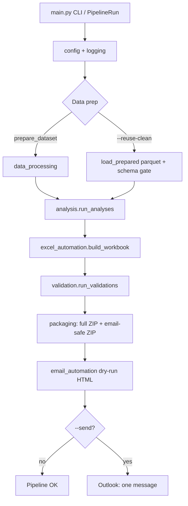

# Python Retail Assessment

> **Project showcase:** https://mona566.github.io/python-retail-assessment/  
> (Source: [`docs/index.html`](docs/index.html) · GitHub Pages from `/docs`)

Online Retail II take-home pipeline: **clean ledger → contract metrics → native Excel PivotTables / PNGs → ZIP → Outlook dry-run**.  
Built to be reviewable — timed stages, fail-loud validation, measured hotspots, and **98% line coverage** on `src/` + `main.py`.

Deeper walkthroughs:

- [docs/ASSIGNMENT_WALKTHROUGH.md](docs/ASSIGNMENT_WALKTHROUGH.md) — assignment mapping  
- [docs/PIPELINE_FLOW.md](docs/PIPELINE_FLOW.md) — function-level flow  

---

## Project overview

This repository turns the UCI **Online Retail II** workbook into a submission package that reviewers can audit:

| Layer | What you get |
|-------|----------------|
| Data | Cross-sheet dedupe, enrich taxonomy, Parquet clean ledger, prep/quality audits |
| Metrics | Single contract (`METRICS_VERSION` **v1.6.2**) for Gross / Net / returns / Top-N |
| Excel | Clean_Data + Summary + six **native** PivotTables + full-table PNGs |
| Delivery | Full ZIP (with xlsx) + email-safe ZIP + Outlook HTML dry-run; send only with explicit flags |
| Quality | 119 pytest cases (synthetic data, no Office); schema gates on `--reuse-clean` |

---

## Technical architecture

`main.py` only orchestrates. Business logic lives in focused `src/` modules.



| Module | Responsibility |
|--------|----------------|
| `src/data_processing.py` | Load (single `ExcelFile`), dedupe, enrich, Parquet, parallel audit I/O |
| `src/metrics.py` | `CONTRACT` / Gross / Net / return taxonomy / Top-N |
| `src/analysis_*.py` | Rankings, anomalies, Summary narrative |
| `src/excel_*.py` | xlsxwriter write, xlwings pivots/PNG, specs as SSOT |
| `src/validation.py` | Prep / analyses / workbook / PNG contracts |
| `src/packaging.py` / `email_automation.py` | ZIP strategies, Outlook dry-run / send |
| `src/logging_utils.py` | `PipelineRun`, `timed_phase`, peak RSS |

---

## Install & run

**Requirements:** Python **3.10+**. Full workbook / PNG / send needs macOS **Microsoft Excel** + **Outlook** (`xlwings`, `appscript`). Unit tests do **not** need Office.

```bash
cd /path/to/python-retail-assessment
python3 -m venv .venv
source .venv/bin/activate
pip install -r requirements.txt
pip install pytest-cov   # optional, for coverage
cp .env.example .env     # set at least CANDIDATE_NAME
```

Place UCI **Online Retail II** at `data/raw/online_retail_II.xlsx`.

```bash
# Full pipeline (no send): clean → analyse → workbook → 6 PNGs → ZIP → email preview
python main.py

# Reuse Parquet (drop flag after enrich/schema changes)
python main.py --reuse-clean

# Preview only, then carefully send one message
python main.py --email-preview-only --send --send-to you@example.com
```

Do not spam `--send` (Outlook.com rate limits). `SUBMISSION_EMAIL` is **never** an automatic recipient.

---

## Data processing flow

1. **Read** — Locate workbook · SHA-256 · one `ExcelFile` + per-sheet `read_excel` (no re-open). Required UCI columns validated per sheet.  
2. **Prepare** — Cross-sheet dedupe · enrich (`is_return_line` / confirmed vs stock adjustment) · vectorized business keys & helpers · write Parquet + audits.  
3. **Analyse** — Shared non-cancellation sales view · product / country / month / returns / customer / timing · IQR anomaly quotas · Summary numbers.  
4. **Store / Excel** — Base book via xlsxwriter · native PivotTables + PNG via xlwings · independent audit files via `ThreadPoolExecutor`.  
5. **Validate & deliver** — Prep / analyses / workbook / PNG checks · full ZIP + email-safe ZIP · Outlook dry-run; `--send` only when asked.

Excel sheet parse and COM stay **single-threaded** (not thread-safe). Threads are used only for **independent file writes**.

---

## Performance metrics (measured)

Environment: **macOS arm64 · Python 3.12** · `python scripts/bench_hotspots.py --rows 100000`  
Source of truth: `output/audit/perf_bench_latest.json` (2026-11-20). Numbers are best-of repeats with `time.perf_counter()` — **not estimates**.

| Hotspot | Before | After | Change |
|---------|--------|-------|--------|
| Business key (`agg("\|\|".join)` → `str.cat`) | 3.156s | 0.162s | **94.9% ↓** |
| Description mode (Python `groupby.agg` → vectorized) | 0.046s | 0.008s | **83.2% ↓** |
| Independent writes (serial → `ThreadPool` / `_run_io_tasks`, 8×2MB) | 0.0024s | 0.0015s | **36.3% ↓** |
| Active sales (`.copy()` → filtered view) | 0.0002s | 0.0001s | **58.3% ↓** |
| Peak RSS during this micro-bench | — | **388.8 MB** | recorded in JSON |

**Observability in the real pipeline:** every stage uses `PipelineRun.step` / `timed_phase` → log lines with duration and `rows_per_sec`; `pipeline_run_*.json` stores `timing_summary` + `peak_rss_mb`.

```bash
python scripts/bench_hotspots.py --rows 100000
```

> Full Online Retail II (~1M rows) wall-clock is still dominated by openpyxl load and xlwings Pivot/PNG. The table above proves the **shipped** prep CPU/I/O fixes.

---

## Testing

| Item | Result |
|------|--------|
| Suite | **119** tests passed (`pytest tests/ -q`) |
| Coverage | **98%** line coverage on `src/` + `main.py` (`coverage.json`: 2018 / 2056 statements) |
| Isolation | Synthetic Online Retail II–style ledger in `conftest`; Excel / Outlook mocked |
| Regression focus | Metrics contract, return taxonomy, Grand Total hide failure, `--reuse-clean` schema, email ZIP policy, CLI exit codes |

```bash
python -m pytest tests/ -q
python -m pytest tests/ -q --cov=src --cov=main --cov-branch --cov-report=term-missing
```

---

## Error handling, retries, and bad input

| Concern | Behaviour |
|---------|-----------|
| Invalid / missing columns | Fail in prep with explicit errors; non-zero exit |
| Stale `--reuse-clean` | `ENRICH_REQUIRED_COLUMNS` / schema gate rejects outdated Parquet |
| Excel row limit | Refuse silent truncation of Clean_Data |
| Blank / tiny PNGs | Validation appends errors → pipeline fails |
| Pivot Grand Total still visible on rate/helper sheets | **Hard error** (not a warning) |
| Invalid `--send-to` | Recipient validation fails before Outlook |
| Oversized workbook for mail | Prefer / require email-safe ZIP; refuse unsafe send |
| Outlook / COM | Dry-run by default; at most one real send; no auto-retry spam |

No silent “almost shipped” path: failed stages write audit state (`PREPARE` → … → `FAILED`) and exit non-zero.

---

## Key design decisions

1. **Metrics contract (`METRICS_VERSION`)** — Gross / Net / return-line taxonomy / Top-N live in one module so Summary, Pivot, and email cannot drift. Meaning changes require a version bump.  
2. **Fail loud** — Prefer a red exit over a green ZIP that looks fine in a screenshot.  
3. **Threads only for independent I/O** — Overlap parquet/CSV/JSON sinks; never parallelize ExcelFile parse or COM.  
4. **Vectorize hot pandas paths** — Business keys and description mode measured before/after in `bench_hotspots.py`.  
5. **SRP modules** — Rankings / anomalies / summary / excel write / pivots / PNG split so long methods stay reviewable.  
6. **Email attachment policy** — Full ZIP for submission; email-safe ZIP omits xlsx when mailbox limits bite; `--send` and preview share the same decision.

---

## Outputs

| Artifact | Notes |
|----------|-------|
| `output/Retail_Analysis.xlsx` | Analysis sheets + hidden compact Pivot sources |
| `output/{CANDIDATE_NAME}_PythonAssessment.zip` | **Full submission (includes workbook)** |
| `output/{CANDIDATE_NAME}_PythonAssessment_EmailSafe.zip` | Mail-friendly (no xlsx); not a substitute for full ZIP |
| `output/png/` | Six Pivot screenshots |
| `output/email_preview/` | Browser preview + CID MIME draft |
| `output/analysis_summary.json`, `output/audit/` | Metrics + prep / revenue audits + timing |

---

## Metrics contract summary (v1.6.2)

Authority: `src/metrics.py` (`CONTRACT`).

- **Gross** = positive qty, non-cancellation `line_revenue`  
- **Return indicator** = `is_return_line` (non-C and Quantity &lt; 0)  
  - **`is_confirmed_return`** (Price &gt; 0) → counts toward `return_value` / Net  
  - **`is_stock_adjustment`** (else, often Price ≤ 0) → `adjustment_units` only, **does not** reduce Net  
- **Returns Top-N rate** = `(returned_units + adjustment_units) / units_sold` (`units_sold >= 50`)  
- **Non-product StockCode** = whitelist only (postage/fees/etc.); alphabetic catalog SKUs stay in product ranking  
- **Anomaly Top 20** = IQR×3 + rules + customer frequency, with 12/4/4 quotas  
- Pivot: Python pre-aggregates hidden sources; Excel builds six native pivots; rate/helper sheets hide bottom Grand Total  

---

## Known limitations & next steps

- macOS Excel + Outlook required for Pivot/PNG/send; CI tests mock those surfaces.  
- ~1M-row workbook often exceeds mailbox limits — email-safe ZIP omits xlsx by design.  
- Full-workbook openpyxl load remains the largest prep wall-clock; faster Excel engines are a follow-up.  
- Publish the showcase via GitHub Pages and point the top README link at the live URL.  
- Optional: surface a full-pipeline timing card from `pipeline_run_latest.json` on fixed CI hardware.

---

## Disclosure

Built with Cursor AI assistance. External references consulted for methodology comparison (not copied as submission code): UCI Online Retail II documentation; public Online Retail II analyses; xlwings PivotTables docs; Microsoft Excel PivotTable / Graph attachment docs. Libraries: pandas, pyarrow, xlwings, openpyxl, xlsxwriter, Pillow, appscript, python-dotenv, pytest, pytest-cov.
