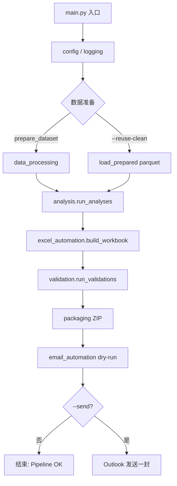

# 代码流程详解（Python Retail Assessment）

本文说明仓库的整体框架、端到端执行顺序、各模块函数职责、输入/输出与文件位置，方便对照作业要求阅读代码。

项目根目录：仓库根目录（含 `main.py` / `src/` / `docs/` 的那一层）。

---

## 1. 整体框架

流水线由 `main.py` 串联，业务逻辑拆在 `src/` 各模块：



| 层次 | 路径 | 职责 |
|------|------|------|
| 入口 | `main.py` | 参数解析、步骤编排、是否发信 |
| 配置 | `src/config.py` | 路径、`.env`（姓名/邮箱，无硬编码密钥） |
| 指标合同 | `src/metrics.py` | Gross/Net；return_line_rate；异常 IQR+配额 Top20（v1.6.0） |
| 数据 | `src/data_processing.py` | 读入、跨表去重、enrich、parquet/审计 |
| 分析 | `src/analysis.py` | 六类分析 + 异常 + Summary 数字 |
| Excel | `src/excel_automation.py` | Clean_Data/Summary/原生 Pivot/PNG |
| 校验 | `src/validation.py` | 数据/分析/工作簿/PNG 断言 |
| 打包 | `src/packaging.py` | 完整 ZIP / 邮件精简 ZIP |
| 邮件 | `src/email_automation.py` | HTML 预览与 Outlook 发送 |
| 测试 | `tests/` | 合成数据单测（不启 Excel/Outlook） |
| 文档 | `docs/PIPELINE_FLOW.md` | 本文 |
| 产出 | `output/` | xlsx、png、zip、audit、email_preview |

---

## 2. 端到端步骤（默认：`python main.py`）

### Step 0 — 启动

| 项目 | 内容 |
|------|------|
| 函数 | `parse_args()`、`setup_logging()`、`ensure_dirs()` |
| 位置 | `main.py`、`src/logging_utils.py`、`src/config.py` |
| 目的 | 解析 CLI；写日志到 `output/logs/`；创建 data/output 目录 |
| 输出 | Logger；空目录就位 |

常用参数：

- `--reuse-clean`：跳过原始 xlsx，读 `data/processed/clean_transactions.parquet`
- `--skip-excel` / `--skip-png` / `--skip-zip`
- `--email-preview-only`：只刷新邮件预览（需已有 workbook + summary）
- `--send` / `--send-to`：真正发 Outlook（慎用）

---

### Step 1 — 数据准备

| 项目 | 内容 |
|------|------|
| 入口函数 | `prepare_dataset()` 或 `load_prepared()` |
| 位置 | `src/data_processing.py` |

**`prepare_dataset` 内部顺序：**

1. **`find_input_workbook`**  
   - 目的：定位 `data/raw/online_retail_II.xlsx`（或 `--input`）  
   - 输出：路径 + 后续 `sha256_file` 指纹

2. **`load_raw`**  
   - 目的：读两个 sheet（Year 2009-2010 / Year 2010-2011），合并并加 `source_sheet` / `source_row` / `load_row_id`  
   - 输出：原始 DataFrame（约 106 万行）

3. **`apply_cross_sheet_dedupe`**  
   - 目的：同一业务主键出现在两张表时，丢掉较早 sheet 的克隆；表内完全重复保留并打标  
   - 输出：`kept`、`removed`；审计 CSV

4. **`enrich`**  
   - 目的：类型清洗；`line_revenue`；取消/退货标记；年月/星期/小时；`product_label`、`Country_NonUK`；Pivot 用 helper 列（distinct 发票/客户、non-UK 收入等）  
   - 输出：分析就绪的 clean DataFrame

5. **落盘与审计**  
   - `data/processed/clean_transactions.parquet`  
   - `output/audit/prep_summary.json`（含跨表 multiset 一致性）  
   - `output/audit/removed_cross_sheet_clones.csv`（删除行；含完整业务主键）  
   - `output/audit/changed_records.csv`（就地规范化，如 StockCode strip；含 before/after）  
   - `output/audit/data_quality_summary.json`（缺失/分类/Excel 余量 + return_line_taxonomy）  
   - `output/audit/revenue_reconciliation.json`（Gross/Net/取消金额恒等式）  

**退货相关标记（避免歧义）：**

| 列 | 含义 |
|----|------|
| `is_return_line` | 作业要求的 return indicator：非取消且 Quantity&lt;0 |
| `is_confirmed_return` | 子类：Price&gt;0 → 进 `return_value` / 扣 Net |
| `is_stock_adjustment` | 子类：其余 return line（多为 Price≤0）→ 只计 `adjustment_units` |
| `return_line_class` | `'confirmed_return'` / `'stock_adjustment'` / 空 |
| `StockCode_raw` | strip 前的原始 StockCode；分析用 `StockCode` |

恒等式：`is_return_line` 行数 = confirmed + stock_adjustment。**不要**再使用模糊的 `is_return`。

**`load_prepared`：** 直接读 parquet + `prep_summary.json`（改 enrich 字段后需重新 prepare 或 re-enrich）。

---

### Step 2 — 业务分析

| 项目 | 内容 |
|------|------|
| 入口 | `run_analyses(clean)` |
| 位置 | `src/analysis.py` |
| 输出对象 | `AnalysisBundle`（summary / 六张分析表 / anomalies / narrative） |
| 落盘 | `output/analysis_summary.json`（在 main 中写入） |

| 函数 | 目的 | 主要输出列 |
|------|------|------------|
| `product_performance` | 产品收入/件数/发票数 Top | StockCode, Description, gross_revenue, … |
| `country_performance` | **排除 UK**；AOV | Country, aov, … |
| `monthly_performance` | 月度；`is_complete_month` | year_month, … |
| `complete_months` | 按全局日期跨度判断完整月 | `set[str]` |
| `returns_performance` | Top-N 按 `return_line_rate`；子类 rate 分列；取消旁注 | return_line_rate, … |
| `customer_value` | 已知客户；AOV | Customer ID, aov, … |
| `sales_timing` | 星期 × 小时收入矩阵 | weekday_label, hour, gross_revenue |
| `country_performance` | 排除 UK；AOV；缺 ID 收入占比 | missing_customer_id_*, … |
| `detect_anomalies` | IQR×k + 规则 + 客户频次；配额 Top20；写 `anomaly_thresholds.json` | reason, relevant_value, score |
| `build_summary` | 邮件/Summary 用 KPI | gross/net/net_after_cancellations、peak_weekday/hour 等 |

口径以 `src/metrics.py` 的 `MetricsContract` 为准（Gross / Return / Cancellation / Net / Net after cancellations）。

---

### Step 3 — Excel 工作簿 + Pivot + PNG

| 项目 | 内容 |
|------|------|
| 入口 | `build_workbook(clean, bundle, audit)` |
| 位置 | `src/excel_automation.py` |
| 输出 | `output/Retail_Analysis.xlsx` |
| PNG | `output/png/Pivot_*.png`（6 张） |

**子流程：**

1. **`_prepare_clean_for_excel`** — 选取 `CLEAN_DATA_COLUMNS`，文本列防 Excel 强制转换  
2. **`_write_base_workbook_xlsxwriter`** — 写  
   - `Clean_Data`  
   - `Summary`  
   - 六张隐藏汇总源表（`Product_Source`、`Country_Source`、`Monthly_Source`、`Returns_Source`、`Customer_Source`、`Timing_Source`）  
   - 六个空 Pivot sheet 占位  
   - `Anomalies`  
3. **xlwings 创建原生 PivotTable**（`PIVOT_SPECS`）  
   - Product：`product_label`  
   - Country：前五个非英国国家，AOV 作为 Pivot 值字段  
   - Monthly / Sales Timing：标准矩阵  
   - Returns：数据源 = `Returns_Source`  
   - Customer：已知客户汇总 + Pivot 内 AOV  
   - 非加总 Grand Total 隐藏（Distinct Count 和比率）  
4. **`export_pivot_pngs`** — 可见 Excel 会话截图；直接截取各原生 Pivot 的完整范围  

| Sheet | 是否作业要求 |
|-------|----------------|
| Clean_Data, Summary, 6×Pivot_*, Anomalies | 是（作业要求） |
| Returns_Source | 辅助：eligible 预聚合；**Pivot_Returns 的原生 Pivot 数据源**（非粘贴表） |
| Monthly_Source | 辅助：含 `is_complete_month`；供 Monthly Pivot 使用 |

**可读性：** 写入 Excel 前将 helper 列重命名为 `Revenue (GBP)` / `Distinct invoices` 等（`CLEAN_DATA_EXCEL_RENAME`），原生 Pivot 显示为 `Sum of Revenue (GBP)` 而非 `inv_flag_*`；并尽量套用 `£` / `%` / 千分位格式。  

**环境：** Phase B 需要本机 Microsoft Excel + xlwings。若 xlsx 超过邮件大小限制，CLI 会阻止发送。

---

### Step 4 — 校验

| 项目 | 内容 |
|------|------|
| 入口 | `run_validations(...)` |
| 位置 | `src/validation.py` |
| 目的 | 行数/指标一致性、UK 不进 country 分析、peak 分拆、sheet/Pivot 存在、PNG 非空 |
| 失败 | `main` 返回码 1 |

---

### Step 5 — 打包

| 函数 | 位置 | 输出 | 说明 |
|------|------|------|------|
| `build_submission_zip` | `src/packaging.py` | `output/<Name>_PythonAssessment.zip` | **完整提交包（含 xlsx）** |
| `build_email_safe_zip` | 同上 | `..._EmailSafe.zip` | 无 xlsx；仅适合邮箱附件 |

---

### Step 6 — 邮件（默认 dry-run）

| 函数 | 位置 | 目的 | 输出 |
|------|------|------|------|
| `build_email_html` | `src/email_automation.py` | 摘要 + 两张图 data-URI 内嵌 | HTML 字符串 |
| `write_dry_run_preview` | 同上 | 浏览器可预览（相对路径图） | `output/email_preview/submission_email_preview.html` 等 |
| `send_submission_email(..., send=True)` | 同上 | Outlook appscript 发送 | `submission_receipt.json` |

作业要求图内嵌在 HTML；实现为 data-URI（Outlook 已发送可见）。Gmail 常剥离 data-URI，故同时附带 PNG 文件作兜底。  
`Retail_Analysis.xlsx` 超过 18MB 时 CLI 阻止发送。完整 ZIP 包含工作簿。预览目录另提供 CID 内嵌的本地 EML 草稿。  
浏览器预览 `submission_email_preview.html` 用相对路径 PNG（同目录拷贝），不再用假 `cid:`。  
六张 PNG 直接来自原生 Pivot 区域，排名表的数据源已限定为要求的 Top-N。PNG 导出失败会中断 pipeline（不再静默带旧图进邮件）。

---

## 3. 目录与产物速查

```
python-retail-assessment/
├── main.py                 # 流水线入口
├── requirements.txt
├── README.md
├── .env / .env.example     # CANDIDATE_NAME, POC_TEST_EMAIL, SUBMISSION_EMAIL
├── docs/
│   └── PIPELINE_FLOW.md    # 本文
├── src/
│   ├── config.py
│   ├── metrics.py
│   ├── data_processing.py
│   ├── analysis.py
│   ├── excel_automation.py
│   ├── validation.py
│   ├── packaging.py
│   ├── email_automation.py
│   └── logging_utils.py
├── tests/                  # pytest（合成数据）
├── scripts/                # Phase0 PoC（可选）
├── data/
│   ├── raw/online_retail_II.xlsx
│   └── processed/clean_transactions.parquet
└── output/
    ├── Retail_Analysis.xlsx
    ├── analysis_summary.json
    ├── png/
    ├── audit/
    ├── email_preview/
    ├── logs/
    └── *_PythonAssessment*.zip
```

---

## 4. 建议阅读顺序（看代码时）

1. `src/metrics.py` — 先搞清数字定义  
2. `main.py` — 步骤骨架  
3. `src/data_processing.py` — `enrich` / 去重  
4. `src/analysis.py` — `run_analyses`  
5. `src/excel_automation.py` — `PIVOT_SPECS` + `build_workbook`  
6. `src/email_automation.py` / `src/packaging.py`  
7. `tests/` — 用合成数据验证规则，无需开 Excel  

运行测试：

```bash
cd /path/to/python-retail-assessment   # repository root
source .venv/bin/activate
python -m pytest tests/ -q
```

---

## 5. 作业要求 ↔ 代码映射（摘要）

| 作业项 | 主要实现位置 | 查看产物 |
|--------|--------------|----------|
| 数据准备 + 审计 | `data_processing.py` | `output/audit/` |
| 六类分析 | `analysis.py` | `analysis_summary.json` + Summary sheet |
| 原生 Pivot | `excel_automation.py` | `Retail_Analysis.xlsx` |
| 异常 Top 20 | `detect_anomalies` | Anomalies sheet + `audit/anomaly_thresholds.json` |
| 六张 PNG | `export_pivot_pngs` | `output/png/` |
| Outlook 邮件 | `email_automation.py` | `email_preview/` |
| ZIP 提交 | `packaging.py` | `{CANDIDATE_NAME}_PythonAssessment.zip` |
| 校验/日志 | `validation.py` / `logging_utils.py` | 控制台 + `output/logs/` |

---

## 6. 已知交付约束（读流程时一并记住）

- 工作簿体积大（Clean_Data + Pivot 缓存）→ 邮件通常无法直附 xlsx；完整 ZIP 保留工作簿。替代邮件附件的提交渠道需要招聘方确认。  
- EmailSafe ZIP **故意不含** xlsx，不能单独当完整作业包。  
- Mac 上 Pivot AutoSort 不可靠 → 大表 PNG 用 Python 侧按指标排序后截取（Pivot 本身仍是原生表）。  
